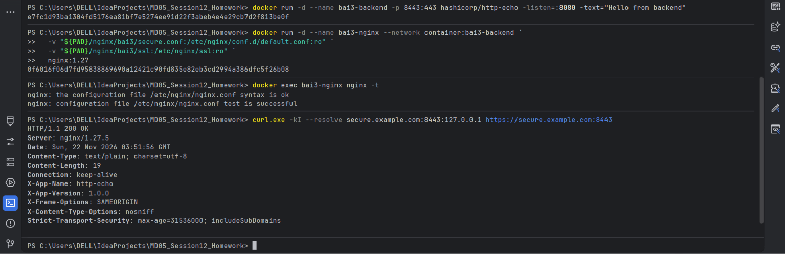

# Bài tập 3: Cấu hình Header Security

## 1. Yêu cầu

Đội Security yêu cầu Nginx trả về các HTTP Security Headers:

- `X-Frame-Options: SAMEORIGIN`
- `X-Content-Type-Options: nosniff`
- `Strict-Transport-Security: max-age=31536000; includeSubDomains`

## 2. Cấu hình hoàn chỉnh

File [`secure.conf`](secure.conf):

```nginx
server {
    listen 443 ssl;
    server_name secure.example.com;

    ssl_certificate /etc/nginx/ssl/server.crt;
    ssl_certificate_key /etc/nginx/ssl/server.key;

    # Security headers
    add_header X-Frame-Options "SAMEORIGIN" always;
    add_header X-Content-Type-Options "nosniff" always;
    add_header Strict-Transport-Security "max-age=31536000; includeSubDomains" always;

    location / {
        proxy_pass http://localhost:8080;
    }
}
```

## 3. Ý nghĩa các header

| Header | Giá trị | Chống tấn công | Ý nghĩa |
|--------|---------|----------------|---------|
| `X-Frame-Options` | `SAMEORIGIN` | Clickjacking | Chỉ cho phép trang được nhúng vào `<iframe>` bởi chính domain của nó, ngăn trang độc hại nhúng trang ẩn để lừa người dùng click. |
| `X-Content-Type-Options` | `nosniff` | MIME-sniffing (XSS qua file upload) | Buộc trình duyệt tuân theo `Content-Type` server trả về, không tự "đoán" kiểu file (vd. không chạy file `.txt` như JavaScript). |
| `Strict-Transport-Security` | `max-age=31536000; includeSubDomains` | SSL stripping / downgrade sang HTTP | Trình duyệt chỉ truy cập domain qua HTTPS trong 1 năm (31536000 giây), áp dụng cho cả subdomain. |

## 4. Giải thích cú pháp `add_header`

```nginx
add_header <Tên-Header> "<giá trị>" [always];
```

- **Dấu nháy kép**: bắt buộc khi giá trị chứa `;` hoặc khoảng trắng (như giá trị của HSTS),
  nếu không Nginx sẽ hiểu `;` là kết thúc chỉ thị.
- **`always`**: mặc định Nginx chỉ thêm header với các mã 200, 201, 204, 206, 301, 302, 303,
  304, 307, 308. Có `always` thì header được trả về cả khi lỗi (4xx, 5xx), tránh bị scanner báo thiếu.
- **Vị trí đặt**: đặt trong `server {}` để áp dụng cho mọi `location`.
  ⚠️ Nếu một `location` có `add_header` riêng thì location đó **không kế thừa** các
  `add_header` của `server` nữa — phải khai báo lại.
- **HSTS chỉ nên gửi qua HTTPS** (server này chỉ `listen 443 ssl` nên đúng).

## 5. Kiểm chứng

### Lệnh trên server thật

```bash
sudo nginx -t                  # kiểm tra cú pháp
sudo systemctl reload nginx    # áp dụng cấu hình

curl -I https://secure.example.com
# Chứng chỉ tự ký thì thêm -k; chỉ lọc 3 header cần kiểm tra:
curl -kIs https://secure.example.com | grep -iE "x-frame|x-content|strict-transport"
```

### Kiểm thử thực tế bằng Docker

Chạy Nginx 1.27 với đúng file `secure.conf`, chứng chỉ tự ký và một backend giả ở cổng 8080.
Container Nginx dùng chung network với backend (`--network container:`) nên `localhost:8080`
trỏ đúng tới backend mà không cần sửa cấu hình.

```powershell
# 1. Tạo chứng chỉ tự ký (thư mục ssl/ đã được .gitignore)
mkdir nginx\bai3\ssl
docker run --rm -v "${PWD}/nginx/bai3/ssl:/ssl" alpine/openssl `
  req -x509 -nodes -newkey rsa:2048 -days 365 `
  -keyout /ssl/server.key -out /ssl/server.crt -subj "/CN=secure.example.com"

# 2. Backend giả lắng nghe cổng 8080
docker run -d --name bai3-backend -p 8443:443 hashicorp/http-echo -listen=:8080 -text="Hello from backend"

# 3. Nginx dùng file secure.conf
docker run -d --name bai3-nginx --network container:bai3-backend `
  -v "${PWD}/nginx/bai3/secure.conf:/etc/nginx/conf.d/default.conf:ro" `
  -v "${PWD}/nginx/bai3/ssl:/etc/nginx/ssl:ro" `
  nginx:1.27

# 4. Kiểm tra cú pháp
docker exec bai3-nginx nginx -t

# 5. Kiểm tra header
curl.exe -kI --resolve secure.example.com:8443:127.0.0.1 https://secure.example.com:8443

# 6. Dọn dẹp
docker rm -f bai3-nginx bai3-backend
```

### Kết quả



```
$ docker exec bai3-nginx nginx -t
nginx: the configuration file /etc/nginx/nginx.conf syntax is ok
nginx: configuration file /etc/nginx/nginx.conf test is successful

$ curl.exe -kI --resolve secure.example.com:8443:127.0.0.1 https://secure.example.com:8443
HTTP/1.1 200 OK
Server: nginx/1.27.5
Content-Type: text/plain; charset=utf-8
Content-Length: 19
Connection: keep-alive
X-App-Name: http-echo
X-App-Version: 1.0.0
X-Frame-Options: SAMEORIGIN
X-Content-Type-Options: nosniff
Strict-Transport-Security: max-age=31536000; includeSubDomains
```

✅ Cấu hình hợp lệ và cả 3 security header đều được trả về.

## 6. Lưu ý thêm

- Nếu backend (vd. Spring Security) cũng tự gửi `X-Frame-Options` / `X-Content-Type-Options`,
  response có thể bị lặp header. Khi đó thêm vào `location /`:

  ```nginx
  proxy_hide_header X-Frame-Options;
  proxy_hide_header X-Content-Type-Options;
  ```

- Không commit private key (`server.key`) lên Git — thư mục `ssl/` đã được thêm vào `.gitignore`.
