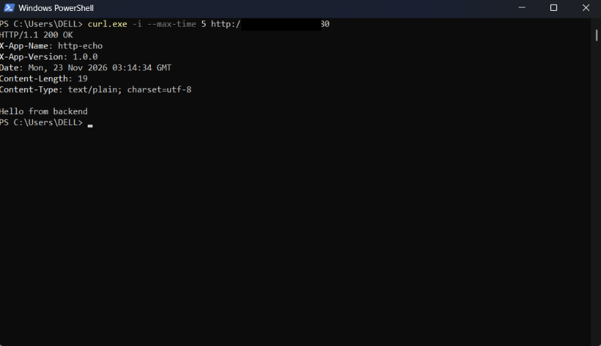
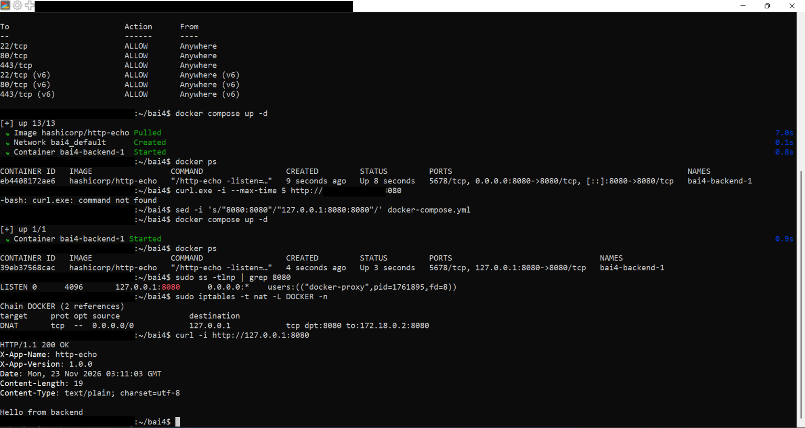
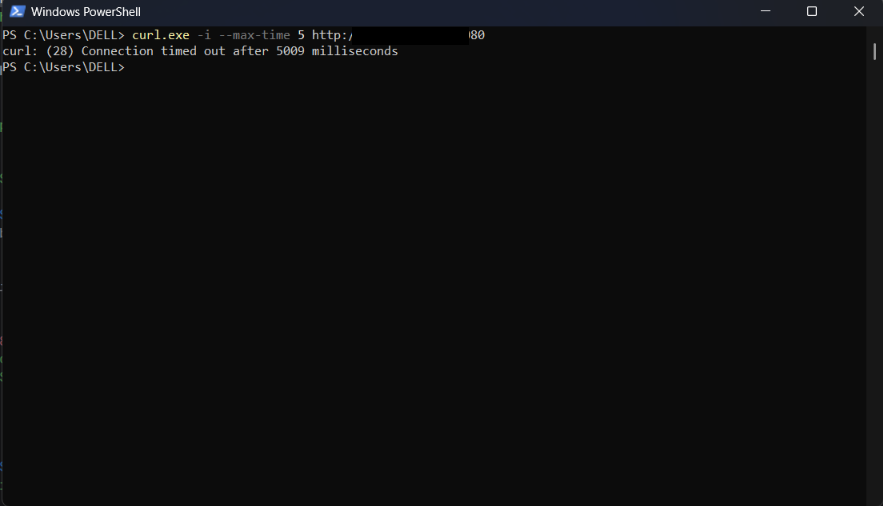

# Bài tập 4: Tích hợp UFW và Docker

## 1. Tình huống

UFW đã chặn cổng `8080` (`sudo ufw deny 8080`), nhưng từ internet vẫn truy cập được
`http://<IP-public>:8080`, vì Docker tự thêm rule vào iptables và đi vòng qua UFW.

`docker-compose.yml` ban đầu:

```yaml
version: '3'
services:
  backend:
    image: my-spring-boot-app:latest
    ports:
      - "8080:8080"
```

## 2. Nguyên nhân: Docker vượt qua UFW như thế nào?

- `"8080:8080"` không ghi IP, nên Docker hiểu là `0.0.0.0:8080:8080`: publish cổng trên **mọi
  network interface**, kể cả IP public (và cả IPv6 `[::]`).
- Docker thêm rule **DNAT** vào bảng `nat` (chain `PREROUTING` → `DOCKER`): gói tin tới cổng 8080
  được đổi đích sang IP của container (vd `172.17.0.2:8080`).
- Sau DNAT, đích không còn là máy host nữa, nên gói tin đi qua chain **`FORWARD`**
  (`DOCKER-USER` → `DOCKER`), **không** đi qua chain `INPUT`.
- Rule của UFW (`ufw-user-input`) lại nằm trong chain **`INPUT`**, nên `ufw deny 8080`
  **không bao giờ được xét** tới với gói tin này.

```
Internet ──► eth0:8080 ──► nat PREROUTING (DNAT của Docker) ──► FORWARD ──► container
                                                                 ▲
                                    UFW nằm ở INPUT ──── không được đi qua ✗
```

## 3. Cấu hình mới

File [`docker-compose.yml`](docker-compose.yml):

```yaml
services:
  backend:
    image: my-spring-boot-app:latest
    ports:
      # Chỉ publish vào loopback: Nginx trên cùng máy vẫn gọi được 127.0.0.1:8080,
      # còn từ internet (IP public) thì không có rule nào để vào được.
      - "127.0.0.1:8080:8080"
```

Thay đổi:

```diff
-version: '3'
 services:
   backend:
     image: my-spring-boot-app:latest
     ports:
-      - "8080:8080"
+      - "127.0.0.1:8080:8080"
```

> Dòng `version` đã được bỏ vì Docker Compose v2 không còn dùng nó và sẽ cảnh báo
> `the attribute 'version' is obsolete`.

Kiểm tra cú pháp bằng `docker compose config`: Compose hiểu đúng `host_ip: 127.0.0.1`:

```
ports:
  - mode: ingress
    host_ip: 127.0.0.1
    target: 8080
    published: "8080"
    protocol: tcp
```

Nginx trên cùng máy proxy vào backend như cũ:

```nginx
location / {
    proxy_pass http://127.0.0.1:8080;
}
```

> Nên ghi `127.0.0.1` thay vì `localhost`: `localhost` có thể được phân giải thành IPv6 `::1`,
> mà Docker chỉ bind ở `127.0.0.1` (IPv4), khi đó Nginx sẽ báo lỗi `502`.

## 4. Port mapping ngăn truy cập trái phép như thế nào?

Cú pháp: `"[HOST_IP:]HOST_PORT:CONTAINER_PORT"`

| Mapping | Docker lắng nghe ở | Từ internet | Nginx trên cùng máy |
|---------|--------------------|-------------|----------------------|
| `"8080:8080"` | `0.0.0.0:8080` (mọi interface) | ✅ Vào được, UFW bị vượt qua | ✅ |
| `"127.0.0.1:8080:8080"` | chỉ `127.0.0.1:8080` | ❌ Bị chặn | ✅ |

- Với `127.0.0.1:8080:8080`, rule DNAT Docker tạo ra **chỉ khớp với gói tin có đích là
  `127.0.0.1`** (`-d 127.0.0.1/32`), và `docker-proxy` cũng chỉ lắng nghe ở `127.0.0.1:8080`.
- Gói tin từ internet có đích là **IP public** của server, nên không khớp rule nào và
  không có tiến trình nào lắng nghe ở `<IP-public>:8080`. Kết quả là kết nối bị từ chối
  (`Connection refused`).
- Địa chỉ `127.0.0.1` (loopback) chỉ tồn tại bên trong chính máy đó, máy khác không thể gửi
  gói tin tới loopback của server. Vì vậy chỉ các tiến trình trên cùng máy, như Nginx, mới gọi được.
- Như vậy chặn được ngay từ việc Docker **không publish cổng ra ngoài**, không cần phụ thuộc
  vào UFW. Người dùng ngoài chỉ vào được qua Nginx (80/443), nơi đã có SSL, security header,
  timeout... (Bài 2, 3).

## 5. Kiểm chứng trên server

```bash
docker compose up -d

# Cột PORTS phải là 127.0.0.1:8080->8080/tcp (không phải 0.0.0.0:8080)
docker ps

# Cổng 8080 chỉ lắng nghe ở 127.0.0.1
sudo ss -tlnp | grep 8080
# LISTEN 0 4096 127.0.0.1:8080 0.0.0.0:* users:(("docker-proxy",...))

# Rule DNAT chỉ áp dụng cho đích 127.0.0.1
sudo iptables -t nat -L DOCKER -n
# DNAT tcp -- 0.0.0.0/0  127.0.0.1  tcp dpt:8080 to:172.18.0.2:8080

# Trên server: gọi trực tiếp được
curl -I http://127.0.0.1:8080

# Qua Nginx: được
curl -I http://<domain>
```

Từ **máy khác** (máy cá nhân):

```bash
curl -I --max-time 5 http://<IP-public>:8080
# curl: (7) Failed to connect ... Connection refused   <- bị chặn ✅
```

## 6. Kết quả kiểm thử thực tế trên VPS Ubuntu

Thực hiện trên VPS Linux (user thường, có quyền sudo), dùng backend giả `hashicorp/http-echo` thay cho
`my-spring-boot-app`. UFW đang bật với chính sách mặc định chặn kết nối vào, chỉ cho phép
22, 80, 443, **không** cho phép 8080. IP public, tên user và hostname đã được che trong ảnh.

```yaml
# ~/bai4/docker-compose.yml dùng để test
services:
  backend:
    image: hashicorp/http-echo
    command: ["-listen=:8080", "-text=Hello from backend"]
    ports:
      - "8080:8080"            # trước khi sửa -> sau đó đổi thành "127.0.0.1:8080:8080"
```

### 6.1. Trước khi sửa (`"8080:8080"`): Docker vượt qua UFW

`docker ps` hiện `0.0.0.0:8080->8080/tcp, [::]:8080->8080/tcp`: Docker mở cổng trên mọi interface
(IPv4 và IPv6). Dù UFW **không** cho phép 8080, máy bên ngoài vẫn gọi được:



```
PS> curl.exe -i --max-time 5 http://<IP-VPS>:8080
HTTP/1.1 200 OK
X-App-Name: http-echo
...
Hello from backend
```

### 6.2. Sau khi sửa (`"127.0.0.1:8080:8080"`): trên VPS



```
$ docker ps
PORTS: 5678/tcp, 127.0.0.1:8080->8080/tcp

$ sudo ss -tlnp | grep 8080
LISTEN 0  4096  127.0.0.1:8080  0.0.0.0:*  users:(("docker-proxy",pid=...,fd=8))

$ sudo iptables -t nat -L DOCKER -n
target  prot opt source      destination
DNAT    tcp  --  0.0.0.0/0   127.0.0.1    tcp dpt:8080 to:172.18.0.2:8080

$ curl -i http://127.0.0.1:8080
HTTP/1.1 200 OK
...
Hello from backend
```

- Cổng 8080 chỉ còn lắng nghe ở `127.0.0.1`, và không còn bind trên IPv6 `[::]`.
- Rule DNAT chỉ áp dụng cho đích `127.0.0.1`.
- Trên VPS (vị trí của Nginx) vẫn gọi backend bình thường.

### 6.3. Sau khi sửa: truy cập từ bên ngoài bị chặn



```
PS> curl.exe -i --max-time 5 http://<IP-VPS>:8080
curl: (28) Connection timed out after 5009 milliseconds
```

Kết quả là **timeout**: không còn rule DNAT nào khớp với IP public, nên gói tin đi vào chain
`INPUT`. Tại đó chính sách mặc định của UFW (chặn kết nối vào) bỏ gói tin đi mà không trả lời.
Tức là **UFW đã có tác dụng trở lại** với cổng 8080.

### 6.4. Tổng kết

| | `"8080:8080"` | `"127.0.0.1:8080:8080"` |
|---|---|---|
| Docker lắng nghe | `0.0.0.0:8080`, `[::]:8080` | `127.0.0.1:8080` |
| Truy cập từ internet | ✅ `200 OK` (vượt qua UFW) | ❌ timeout (bị chặn) |
| Truy cập từ chính VPS (Nginx) | ✅ | ✅ `200 OK` |

## 7. Cách khác (tham khảo)

| Cách | Mô tả |
|------|-------|
| Bỏ `ports`, dùng `expose` + chạy Nginx trong cùng Docker network | Backend không publish cổng nào ra host, Nginx gọi `http://backend:8080`. An toàn nhất nếu Nginx cũng chạy bằng Docker. |
| Thêm rule vào chain `DOCKER-USER` | Docker luôn xét chain này trước, có thể chặn theo IP/cổng. Áp dụng khi bắt buộc phải publish ra ngoài nhưng chỉ cho một số IP. |
| `"iptables": false` trong `/etc/docker/daemon.json` | Không khuyến khích: Docker không tự cấu hình NAT nữa, container dễ mất kết nối mạng. |
